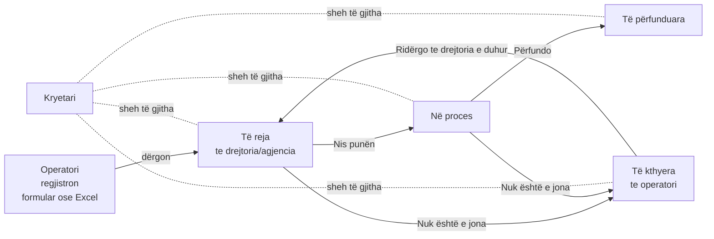

# Rrjedha e punës (workflow)

How a citizen's request moves through the municipality, and what each role sees.
Use this when presenting the dashboard.

## In one sentence

The **Operatori** registers each request from the protocol and sends it to the right
**Drejtori** or **Agjenci**. The unit works it through to the end (or sends it back if it
isn't theirs), and the **Kryetari** sees every unit side by side, with the delays highlighted.

## The request (one line of the protocol register)

| Field | Example | Notes |
|---|---|---|
| Nr. protokolli | K-2026-0472 | Unique. The form suggests the next number |
| Data | 25.09.2026 | Picked from a calendar. Cannot be in the future |
| Lënda | Kërkesë për ndihmë ekonomike | Free text, with suggestions from earlier subjects |
| Dërgohet te | Drejtoria e Shërbimeve Sociale | One drejtori or agjenci |

Each unit has a standard deadline (**afati**), e.g. Shërbimet Sociale 15 days and Shërbimet
Publike 5 days. Deadline = registration date + afati. A request that is still open after its
deadline is shown as **me vonesë** (late) everywhere.

## Statuses

| Status | Meaning | Who moves it on |
|---|---|---|
| **E re** | Sent to the unit, not started yet | The unit: *Nis punën* |
| **Në proces** | The unit is working on it | The unit: *Përfundo* |
| **E përfunduar** | Done. The completion date is kept, so "brenda afatit" (on time) can be measured | – |
| **E kthyera** | The unit said it isn't theirs, with a reason | The operator: *Ridërgo* to the right unit |

Every step is written to the request's **historiku** (who, when, and a note).

## What each role sees

### Operatori (the protocol office)
- **Regjistro kërkesë**: the form (number, calendar, subject, unit). Next to it: *Regjistruar sot*
  and the *Të kthyera* list that needs resending.
- **Ngarko Excel**: many requests at once. The operator chooses a file, the system **checks it
  first**, and shows the rows that are ready and the rows with problems (e.g. unknown unit,
  missing date, repeated number). Only then does the operator press *Dërgo*. A template with a
  drop-down list of units is available to download.
- **Regjistri**: every request, filtered by period (calendar), unit, status and search.

### Drejtoria / Agjencia (one account per unit)
- **Paneli**: its own dashboard only: new, in progress, late, % on time, the workflow with
  counts, requests per week, most frequent subjects, and "Kërkojnë vëmendje" (closest deadlines).
- **Kërkesat**: the inbox. Open a request, then *Nis punën*, *Përfundo* or *Nuk është e jona*.
- A unit never sees another unit's requests. The server enforces this, not just the screen.

### Kryetari (the mayor)
- **Pasqyra**: the whole municipality in one sentence ("61 kërkesa, 83% brenda afatit,
  6 me vonesë, më shumë te Shërbimet Sociale"), the workflow, and all units side by side with a
  verdict: *Në rregull* / *Për t'u ndjekur* / *Kërkon vëmendje*.
- **Drejtoritë & agjencitë**: one card per unit. Opening one shows the same dashboard the unit
  sees, read-only, plus its requests.
- **Regjistri**: everything, with filters.

### Raporti (Drejtoria and Kryetari)
A written report for **last week** by default, or any period: *Kjo javë*, *7 ditët e fundit*,
*Ky muaj*, or any dates from the calendar. The mayor picks the whole municipality or one unit;
a unit always gets its own.
- The numbers (requests, completed, % on time, change vs the previous period of the same length,
  top subjects, late requests) are **always computed from the register**.
- The text (headline, summary, *Çfarë shkoi mirë*, *Shqetësime*, *Rekomandime*) is written by
  **AI (OpenAI, via the Python service)** when `OPENAI_API_KEY` is set in `backend/.env`. The AI only receives the
  computed numbers and is told not to invent any. Without a key, or if the call fails, the same
  text is written by rules. The page always labels which one wrote it.
- "Me vonesë sot" counts every open request past its deadline today, even if it was registered
  earlier: a weekly report must not hide old backlog.
- *Printo / PDF* prints just the report. *Rigjenero* writes it again.

### Everyone: Pyet asistentin
Questions in plain Albanian, e.g. *"Sa kërkesa kemi këtë muaj?"*, *"Cila drejtori ka më shumë
kërkesa të vonuara?"*, *"Si po ecën Urbanistika?"*. Answers are computed from the same numbers as
the dashboard (the assistant never invents a figure) and respect the role: a unit only gets its
own numbers.

## Demo script (5 minutes)

1. **Operatori**: register a request for Shërbimet Sociale with the calendar. Show the Excel
   upload: download the template, upload a file, and point out the rows the check caught.
2. **Drejtoria e Shërbimeve Sociale**: the new request is in *Kërkesat*. Start it, complete
   it, and show the history.
3. **Kryetari**: *Pasqyra* shows Shërbimet Sociale needs attention. The weekly chart shows the
   September wave of *ndihmë ekonomike* requests. Open the unit's card.
4. **Pyet asistentin**: "Cila drejtori ka më shumë kërkesa të vonuara?"

## Mock data

60 requests over the last 11 weeks across 4 drejtori and 2 agjenci, generated in
`backend/src/requests/requests.mock.ts` (units in `backend/src/units/units.mock.ts`). The data
is kept in memory, so a backend restart returns to the same mock set. Replace these files (or
add a database) when the real data arrives.
